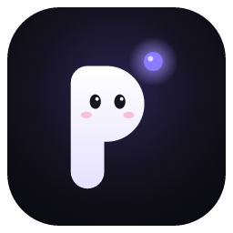
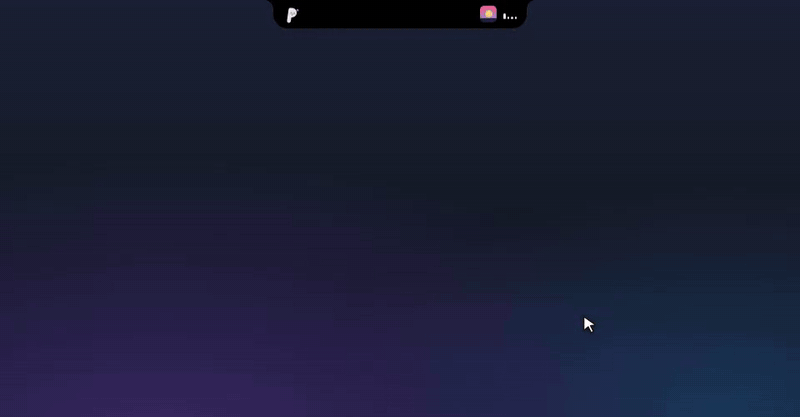
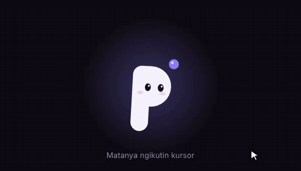

<div align="center">



# PoinTify

**Asisten kecil yang tinggal di atas layar Windows.**
Notch ala Dynamic Island dengan musik dan lirik sinkron, timer fokus, pengingat minum, rak file, dan chat langsung sama Claude buat ngerjain project.


<br>



<sub>Musik dan lirik, chat sama Claude, izinin perintah Claude Code dari notch, dan notif pas kerjaannya beres. Demo pakai data contoh.</sub>

</div>

---

## Unduh

Ambil installer terbaru di [halaman Releases](https://github.com/ShineReborn-Creative/PoinTify/releases/latest): file `PoinTify_<versi>_x64-setup.exe`. Installer-nya dipasang buat akun lu aja, jadi nggak minta izin Administrator.

Installer-nya belum ditandatangani, jadi Windows mungkin nampilin "Windows protected your PC". Klik **More info**, lalu **Run anyway**.

## Kenalan sama Pip

<p align="center"></p>

Maskot PoinTify namanya **Pip**: huruf P yang hidup. Titik bercahaya di sampingnya itu unsur **"point"**, dan pas ada yang perlu lu tahu, titik itu berubah jadi badge notifikasi yang lompat-lompat, itu unsur **"tify"**.

Pip digerakin mesin animasi kecil buatan sendiri ([`src/pip/engine.ts`](src/pip/engine.ts)), tanpa gambar, Lottie, atau library animasi. Tiap bagian badannya (gepeng, miring, lompat, arah mata, kelopak, posisi titik) pakai simulasi pegas, jadi gerakannya mantul dan nyambung, bukan animasi yang diulang-ulang.

- **Ngikutin kursor.** Rust ngirim posisi kursor global, jadi mata Pip ngelirik ke mana pun kursor lu di layar, badannya ikut condong dikit.
- **Bisa diajak main.** Klik sekali dia kesel, klik dua kali dia dadah, klik tiga kali cepet dia pusing. Tahan kursor di atasnya dua detik, matanya jadi hati.
- **Bisa keluar dari notch.** Seret Pip ke bawah, dia jadi pet desktop beneran:
  - **Fisika:** ada gravitasi, bisa dilempar (mantul di pinggir layar, pusing kalau kekencengan), dan nangkring di pinggir atas jendela lain. Jendelanya digeser, Pip ikut; ditutup, dia jatuh.
  - **Gerak sendiri:** jalan, lari, loncat-loncat, manjat pinggir layar terus nempel di sana.
  - **Interaksi:** gosok kursor bolak-balik buat ngelus, klik dua kali buat buka notch, klik kanan buat menu (kasih minum, main bola, kejar-kejaran, tidur). Seret file dari Explorer atau desktop: Pip mangap nunggu, dan kalau dilepas di atasnya dia ngunyah sambil komentar sesuai jenis filenya. Filenya dicatet diem-diem ke Rak (notch nggak ikut kebuka, file aslinya tetap di tempat).
  - **Main sama kursor:** kursor diem di deket Pip, dia nyamperin dan ngeliatin; digoyang-goyang, dia ngeringkuk terus nerkam; dilempar cepet ke arahnya, dia loncat ngehindar.
  - **Hidup bareng lu:** balon omongan pendek, ikat kepala pas timer fokus, laptop mini pas Claude kerja, joget pas musik, tidur siang kalau dicuekin.
  - **Papan Live:** nenteng info widget Live; kalau penting, lari ke notch sambil ngacungin papannya.
  - Semua bisa diatur di Pengaturan › Pip desktop. Lepas di area notch buat masukin lagi.
- **Hidup sendiri.** Ngedip di waktu acak, lirik kanan-kiri, ngulet, mainin titiknya sendiri, dan nguap kalau lama didiemin.
- **Ekspresi per keadaan.** Santai, nyapa, mikir (titiknya muter), kerja, ngasih tahu, senang pas tugas beres, nunggu file, goyang ngikutin ketukan pas musik diputer, error, dan tidur.

## Fitur

| Fitur | Yang terjadi |
|---|---|
| **Notch** | Pil hitam di atas layar. Arahin kursor ke sana, dia melebar di tengah layar. Pilnya bisa diseret ke kiri atau kanan kalau ngalangin (Pip-nya ikut kegoncang, diguncang terus malah pusing), dan posisinya diinget. Klik di luar atau tekan `Esc` buat nutup. Area di sekitarnya tembus klik, jadi nggak ngalangin app lain. |
| **Beranda = kanvas widget** | Beranda isinya widget yang bisa lu susun sendiri: 2 baris, dan notch-nya makin lebar tiap widget nambah (kalau udah mentok lebar layar, tinggal geser). Tahan lama widget mana aja atau klik ikon grid buat masuk mode **Atur**: widget goyang, seret buat mindahin, ganti ukuran (kecil, lebar, besar, jumbo), hapus, atur isinya, atau tambah dari galeri. Susunannya kesimpen di pengaturan. |
| **22 widget** | Jam (+zona kedua), kalender, hitung mundur, to-do, catatan, riwayat clipboard, timer fokus, minum air, peluncur app/folder/link, usage Claude (hitung mundur reset + notif), prompt cepat (`{clipboard}` diganti teks yang lagi dicopy), sesi Claude, musik, Pip, sistem (CPU, RAM, disk, baterai), internet, tombol cepat (volume, mic, mode tenang), cuaca ([Open-Meteo](https://open-meteo.com)), jadwal sholat ([Aladhan](https://aladhan.com), metode Kemenag), kurs ([Frankfurter](https://frankfurter.dev)), GitHub, dan widget kustom yang ngambil angka dari API JSON mana aja. |
| **Live di notch kecil** | Widget yang Live-nya nyala ngelapor ke notch kecil pas ada yang penting: hitung mundur tinggal sejam, 15 menit sebelum sholat, usage mau reset, baterai sekarat, CPU mentok, disk mau penuh. Pip juga ikut ngerasain: keringetan pas CPU panas, lemes pas baterai mau habis, kehujanan kalau di luar hujan. |
| **Musik + lirik** | Baca lagu dari kontrol media Windows (Spotify, YouTube di browser, dll): cover, judul, artis, progress yang bisa diklik buat lompat, tombol putar. Lirik sinkron dari [LRCLIB](https://lrclib.net) jalan ngikutin lagu. |
| **Chat dengan Claude** | Ngobrol sama Claude langsung dari notch lewat Claude Code, pakai login langganan Claude lu. Mode **Ngobrol** (cuma baca, buat brainstorm) dan **Kerjain** (boleh ngedit file di folder project). Pilih Opus, Sonnet, atau Haiku. Sesi bisa dilanjutin di Claude Desktop. |
| **Sesi Claude Code** | Sesi `claude` yang lu jalanin di terminal mana aja muncul di tab Sesi: prompt, file yang dibaca dan diedit (+baris −baris), perintah yang dijalanin. Pas Claude minta izin, kartu nyembul dari notch dengan pilihan Izinin, Selalu, Tolak, atau jawab di terminal. Pertanyaan pilihan ganda dari Claude juga bisa dijawab dari notch. Pas sesi beres, Pip lompat senang. |
| **Progres chat Claude** | Kerjaan yang lagi dikerjain Claude di app Claude (chat yang nyambung ke PC) ikut kepantau: judul tugas, langkah ke berapa, dan notif pas Claude beres atau butuh jawaban. Claude nulis kabar kecil ke `~/.pointify/feed`, PoinTify mantau folder itu. |
| **Rak file** | Drag file ke notch buat disimpan sementara, drag keluar lagi ke app lain, atau lampirin ke chat Claude. |
| **Timer fokus** | Pomodoro lengkap: fokus, istirahat pendek, istirahat panjang, statistik harian. Hitung mundurnya keliatan di notch kecil. |
| **Pengingat minum** | Pip nyembul dari notch tiap sekian menit, ngitung gelas harian, cuma di jam aktif yang lu atur. |
| **Lain-lain** | Sembunyi otomatis pas ada app fullscreen, ikon di system tray, shortcut global `Ctrl+Alt+P` buat buka chat, jalan otomatis pas Windows nyala, suara orisinal yang dibikin pakai Web Audio. |

## Privasi

PoinTify jalan di PC lu dan nggak punya server sendiri. Yang keluar dari PC cuma ini, dan cuma kalau fiturnya dipakai:

| Fitur | Yang dikirim | Ke mana |
|---|---|---|
| Lirik | Judul & artis lagu | [LRCLIB](https://lrclib.net) |
| Cuaca & jadwal sholat | Koordinat (dibuletin ±100 m) atau nama kota | [Open-Meteo](https://open-meteo.com), [Aladhan](https://aladhan.com), [BigDataCloud](https://www.bigdatacloud.com) (nama daerah) |
| Kurs, GitHub, widget kustom | Permintaan biasa ke alamat API-nya | Frankfurter, GitHub, alamat yang lu isi sendiri |
| Ikon link di Peluncur | Nama domain | Situs itu sendiri, cadangannya DuckDuckGo |
| Chat Claude | Pesan lu | Anthropic, lewat Claude Code di PC lu |

Yang nggak pernah keluar dari PC:

- **Riwayat clipboard:** cuma dipantau selama widget Clipboard dipasang, disimpen di memori, hilang pas PoinTify ditutup.
- **Deteksi ngetik buat Pip:** cuma ngitung jumlah pencetan; tombol mana yang dipencet langsung dibuang, nggak pernah disimpen atau dikirim.
- **Pengaturan, susunan widget, dan Rak:** tersimpan sebagai file JSON di folder aplikasi.

## Arsitektur

```
src/                      React + TypeScript (tampilan)
├── island/               Notch: keadaan kecil, peek, kebuka + tab
│   └── tabs/             Chat, Sesi, Rak, Fokus
├── widgets/              Kanvas Beranda: grid, mode Atur, galeri, semua widget, Live
├── settings/             Jendela pengaturan
├── pip/                  Mesin animasi Pip (pegas, ekspresi, partikel)
├── pet/                  Tampilan Pip di desktop
├── components/           Pembungkus React buat Pip, ikon, ring progres
├── state/                Store kecil per fitur (tanpa library state)
└── lib/                  Pembungkus command Tauri, suara, markdown

src-tauri/src/            Rust (backend)
├── island.rs             Posisi notch, click-through, deteksi hover & app fullscreen
├── media.rs              Kontrol media Windows (SMTC) lewat crate `windows`
├── lyrics.rs             Lirik LRCLIB + parser LRC + cache
├── claude.rs             Menjalankan `claude -p` dan meneruskan aliran JSON-nya
├── agents.rs             Server lokal buat hooks: sesi terminal, izin, pertanyaan
├── hook_relay.rs         `pointify.exe --hook`: oper kejadian hook ke PoinTify
├── claude_hooks.rs       Pasang/copot hooks di ~/.claude/settings.json
├── feed.rs               Pantau ~/.pointify/feed buat progres chat Claude
├── pet.rs                Pip desktop: fisika (gravitasi, lemparan, nangkring di jendela), gerak, mampir notch
├── geo.rs                Lokasi PC dari layanan lokasi Windows (cuaca & jadwal sholat)
├── shelf.rs              Rak file (disimpan sebagai JSON)
├── sys.rs                CPU, RAM, disk, baterai, internet, volume & mic (API Windows langsung)
├── clipboard.rs          Riwayat clipboard di memori (nggak pernah ditulis ke disk)
├── widgets.rs            Ambil JSON dari internet & buka app/folder/link buat widget
├── settings.rs           Pengaturan, autostart, shortcut global
└── tray.rs               Menu system tray
```

Beberapa keputusan teknis yang menarik:

- **Click-through yang tetap bisa di-hover.** Jendela notch selalu tembus klik. Thread Rust ngecek posisi kursor tiap 30 ms dan baru "nangkep" mouse kalau kursor masuk area pulau. Frontend ngirim ukuran pulau terbaru tiap bentuknya berubah.
- **Posisi lagu tanpa polling berat.** Windows cuma ngasih posisi lagu pas ada kejadian (play, pause, seek). PoinTify nyimpen posisi terakhir plus kapan diambil, lalu ngitung sendiri posisi sekarang di frontend.
- **Chat lewat Claude Code, bukan API key.** `claude -p --output-format stream-json` dijalankan di folder project. Prompt dikirim lewat stdin biar aman dari urusan tanda kutip, dan proses dihentikan pakai `taskkill /T` supaya anak prosesnya ikut berhenti.

- **Widget yang hemat.** Data yang dipakai banyak widget (misalnya statistik sistem) diambil sekali dan dibagi bareng, cuma selama ada widget yang nampilin. Permintaan internet lewat Rust (nggak kena CORS), dibatesin 12 detik dan 2 MB. Grid-nya disusun kolom demi kolom (2 baris), jadi lebar notch tinggal ngikutin jumlah kolom.

- **Hooks yang nggak pernah ngeganggu.** Claude Code menjalankan `pointify.exe --hook` di tiap kejadian. Exe yang sama dipakai sebagai relay: dia keluar sebelum aplikasi Tauri dibikin, ngoper datanya lewat socket lokal (127.0.0.1 plus token acak), dan selalu keluar dengan kode 0. Kalau PoinTify lagi mati, relay langsung keluar tanpa output, jadi Claude Code jalan seperti biasa. Permintaan izin ditahan sampai dijawab di notch, dan kalau prosesnya dibatalin dari terminal, kartunya ikut hilang.

## Menjalankan

Yang dibutuhkan: [Node.js](https://nodejs.org), [Rust](https://rustup.rs), dan Microsoft C++ Build Tools (workload *Desktop development with C++*).

```powershell
npm install
npm run tauri dev
```

Bikin installer:

```powershell
npm run tauri build
```

Hasilnya ada di `src-tauri\target\release\bundle\nsis\PoinTify_<versi>_x64-setup.exe`. Tiap tag versi baru (misalnya `v0.3.0`) yang di-push ke GitHub, workflow [Rilis](.github/workflows/release.yml) bikin installer yang sama secara otomatis dan nyiapin draft rilis.

### Chat dengan Claude

Fitur chat butuh [Claude Code](https://code.claude.com/docs/en/setup) dan langganan Claude (Pro, Max, Team, atau Enterprise):

```powershell
irm https://claude.ai/install.ps1 | iex
```

Setelah itu buka tab Chat di PoinTify dan ikutin langkah login-nya.

## Terima kasih

- [Coucou](https://github.com/Louis-CFM/coucou) sebagai inspirasi pola notch di Windows. PoinTify nggak memakai nama, karakter, ikon, maupun suara Coucou.
- [LRCLIB](https://lrclib.net) untuk lirik sinkron.
- [Tauri](https://tauri.app) dan crate [`windows`](https://github.com/microsoft/windows-rs).
